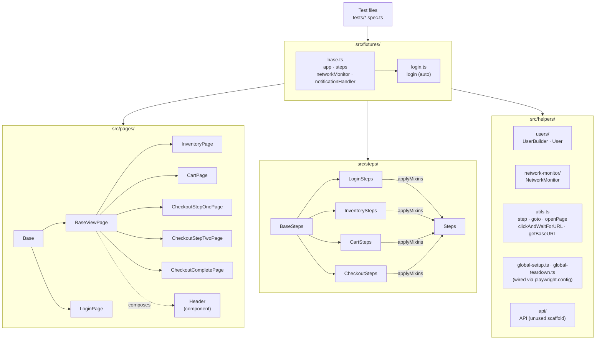

# Playwright Test Suite Showcase

A production-grade Playwright test suite demonstrating best practices for end-to-end testing: page object model, composable fixtures, typed step abstractions, network monitoring, and route interception. The suite targets [saucedemo.com](https://www.saucedemo.com/), a stable public demo storefront, so it can be run by anyone without needing a private test environment.

---

## Features

- **Page Object Model** — scoped locators, component hierarchy, clean separation of concerns
- **Composable Steps** — mixin-assembled `Steps` class as the primary test API
- **Custom Fixtures** — auto-login, notification handler, network monitor
- **Network Monitor** — opt-in request capture with JSON + CSV reports
- **Custom Matchers** — e.g. `toBeWithTolerance` for floating-point assertions
- **User Builder** — fluent builder pattern with pre-flight env validation
- **Global Setup/Teardown** — fail-fast env validation before the run starts, teardown hook ready for cleanup

---

## Setup

```bash
npm install
npx playwright install
cp env.template .env   # fill in credentials
```

Required environment variables: `URL` (app base URL, e.g. `www.saucedemo.com`) and `USERS_PASSWORD` (shared password for every SauceDemo test account, e.g. `secret_sauce`) — both are checked once by `globalSetup` before the run starts, failing fast with a clear message if either is missing. Optionally, `WORKERS` overrides the local parallel worker count.

---

## Commands

```bash
# Run all tests
npm test

# Interactive UI mode (time-travel debugging, watch mode)
npm run test:ui

# Open last HTML report
npm run report

# Type-check, lint, and check formatting (or `npm run check` to run all three)
npm run typecheck
npm run lint
npm run format:check   # `npm run format` to fix

# Find unused files, exports, and dependencies
npm run deadcode

# Run a single spec file
npx playwright test tests/checkout.spec.ts

# Target a specific browser project
npx playwright test --project 'Desktop Chrome, standard user'

# Capture network traffic for tagged tests
NETWORK_MONITOR=true npx playwright test --grep @NETWORK_MONITOR
```

---

## Architecture

The suite is layered: test files talk only to fixtures, fixtures compose page objects and steps, and steps orchestrate actions through page objects. Outside that per-test flow, `playwright.config.ts` wires up `global-setup.ts`/`global-teardown.ts` (env validation before the run; teardown is currently a no-op) and an unused `api/` scaffold showing how a real backend would be called directly via `APIRequestContext`.



### Page Object Hierarchy

`Base` holds `page` and `root` (a `Page` or `Locator`), and exposes `getByTestId`, `getByRole`, `locator`, and `waitForResponse`. Components extend `Base` and override `root` to scope all their locators to a container element — no leaking selectors. `LoginPage` (the pre-auth page) extends `Base` directly; every authenticated view extends `BaseViewPage`, which composes a `Header` component (burger menu, nav links, cart icon/badge) shared across all logged-in pages.

SauceDemo tags elements with `data-test` (not `data-testid`), so `playwright.config.ts` sets `use.testIdAttribute: 'data-test'` — `getByTestId` resolves against that attribute everywhere in the suite.

### Steps

`Steps` (`src/steps/index.ts`) is assembled via `applyMixins` from focused step classes:

| Class | Methods |
|---|---|
| `LoginSteps` | `checkLoginPage`, `attemptLogin`, `checkLoginError` |
| `InventorySteps` | `openInventoryPage`, `addItemToCart`, `removeItemFromCart`, `checkCartBadgeCount`, `sortProductsBy` |
| `CartSteps` | `openCartPage`, `checkCartContainsItems`, `removeItemFromCartPage`, `proceedToCheckout` |
| `CheckoutSteps` | `fillCheckoutInfo`, `continueToOverview`, `attemptContinueToOverview`, `checkCheckoutInfoError`, `checkOrderTotal`, `finishCheckout`, `checkOrderComplete` |

Steps are injected via the `steps` fixture and are the primary orchestration API in tests. The reasoning behind the mixin approach is recorded in [docs/decisions/0001-steps-via-mixins.md](docs/decisions/0001-steps-via-mixins.md).

### Fixtures

All test files import from `src/fixtures` — never directly from `@playwright/test`.

| Fixture | Type | Description |
|---|---|---|
| `app` | manual | Page object container (`loginPage`, `inventoryPage`, `cartPage`, `checkoutStepOnePage`, `checkoutStepTwoPage`, `checkoutCompletePage`, `notification`) |
| `steps` | manual | Composed `Steps` instance |
| `login` | auto | Navigates to login and authenticates before each test |
| `notificationHandler` | auto | Registers a `page.addLocatorHandler` that waits out `[role="alert"]` notifications whenever they appear |
| `networkMonitor` | auto | Opt-in request recorder (requires `@NETWORK_MONITOR` tag) |

`user` is a project-level test option (default `standardUser`) that picks which SauceDemo account the `login` fixture uses — set per project in `playwright.config.ts` (currently `Desktop Chrome, standard user` and `Mobile Chrome, standard user`).

### Writing Tests

```typescript
import { test, expect } from 'src/fixtures';

test.describe(() => {
  test('Adding an item to the cart updates the cart badge', async ({ app, steps }) => {
    await steps.addItemToCart('Sauce Labs Backpack');
    await steps.checkCartBadgeCount(1);
  });
});
```

- Tests requiring authentication → import from `src/fixtures` (auto-login included)
- Tests covering the login page itself → import from `src/fixtures/base` (no auto-login)

### Assertions

```typescript
// Descriptive label for non-obvious assertions
await expect(element, 'Table should have rows').toHaveCount(n);

// Async retry for multi-step interactions
await expect(async () => { /* actions + assertion */ }).toPass();

// Polling until condition is met
await expect.poll(async () => someCondition).toBeTruthy();

// Custom matcher: floating-point comparison with tolerance
expect(received).toBeWithTolerance(expected, { tolerance: 0.1 });
```

### Network Monitor

Tag a test with `@NETWORK_MONITOR` and run with `NETWORK_MONITOR=true` to record all network traffic. Reports land in `./network-report/{tags}/{project}/{timestamp}/` as JSON and CSV, split into backend requests (XHR/fetch/WebSocket) and static assets.

### User Builder

```typescript
const user = new UserBuilder('Standard', 'standard_user').validate().build();
```

`validate()` asserts that the shared `USERS_PASSWORD` env var exists before the test starts. `build()` returns the plain `User` object. SauceDemo publishes several fixed accounts (`standard_user`, `locked_out_user`, `problem_user`, `performance_glitch_user`, `error_user`, `visual_user`) that all share one password — `users.ts` builds each of them.

---

## Conventions

| Topic | Rule |
|---|---|
| Timeouts | Underscored literals — `5_000`, `20_000`, `60_000` |
| Waiting | `element.waitFor({ state })` or `expect.poll()` — never `page.waitForTimeout()` |
| Locators | `getByTestId` → `getByRole` → semantic `locator` — never CSS classes |
| Imports | Always use the `src/*` path alias — no `../../` traversals |
| Step reuse | Actions used more than once belong in a step class with `@step()` |
| `test.only` | Forbidden — `forbidOnly: true` is enforced in CI |
| Formatting | Prettier (`npm run format`) — single quotes, 120 columns |
